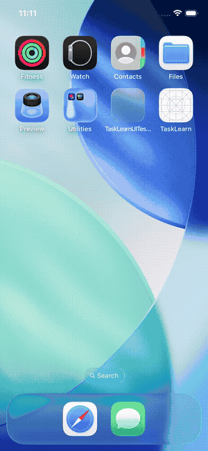
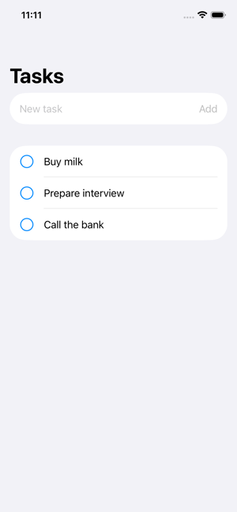
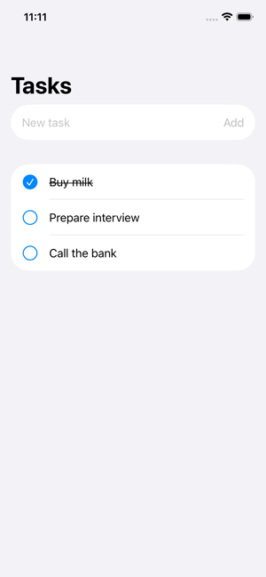
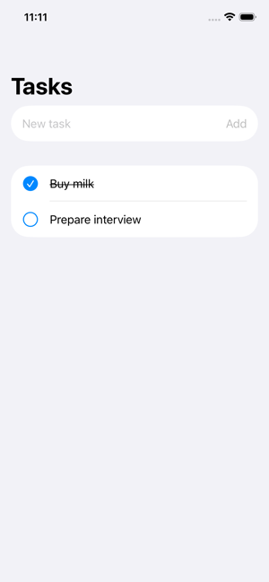

# TaskLearn

[](https://github.com/japhet175/tasklearn/actions/workflows/ci.yml)

A small **learning project**: an iOS task list in SwiftUI, with Swift Concurrency and GRDB (SQLite).
It is not production experience. I built it to practise the pieces a real iOS codebase uses.

## See it running

The app below is built and driven by a UI test on an iPhone simulator in GitHub Actions, on every push.
The test adds three tasks, completes one, deletes one, then **relaunches the app** to check the data was saved to SQLite.

<p>
  
</p>

| Tasks added | One completed | One deleted | After relaunch |
| --- | --- | --- | --- |
|  |  |  |  |

## What it shows
- `TaskCore` (Swift package): model, SQLite storage with GRDB, versioned migrations, async API, live observation.
- Tests with Swift Testing, including one that checks existing user data survives a new migration.
- SwiftUI screen with an `@Observable`, `@MainActor` view model and `.task` for observation.
- Accessibility labels and values on rows.
- An XCUITest of the full user flow, run in CI with screenshots and a screen recording.

## Architecture

```
TodoListView (SwiftUI)        draws the screen, forwards taps
        │
TodoListViewModel             @MainActor @Observable, screen logic and errors
        │
TodoStore (TaskCore)          GRDB DatabaseQueue, migrations, async reads/writes
        │
SQLite file (tasks.sqlite)
```

Writes go down through the store. The list on screen is never edited by hand: it comes back up through
`ValueObservation`, so the database is the single source of truth.

| File | What to look at |
| --- | --- |
| [`TodoItem.swift`](TaskCore/Sources/TaskCore/TodoItem.swift) | Value type, `Sendable`, GRDB record |
| [`TodoStore.swift`](TaskCore/Sources/TaskCore/TodoStore.swift) | Migrations `v1` → `v2`, async API, `observeAll()` |
| [`TodoStoreTests.swift`](TaskCore/Tests/TaskCoreTests/TodoStoreTests.swift) | In-memory DB tests, migration upgrade test |
| [`TodoListViewModel.swift`](App/TodoListViewModel.swift) | `@MainActor`, observation loop, error handling |
| [`TodoListView.swift`](App/TodoListView.swift) | `.task` lifetime, swipe to delete, accessibility |
| [`TaskLearnUITests.swift`](UITests/TaskLearnUITests.swift) | End-to-end user flow including relaunch |

## Run it

**Logic tests** (macOS or Linux with Swift 6):
```bash
cd TaskCore
swift test
```

**App and UI tests** (macOS with Xcode):
```bash
brew install xcodegen
xcodegen                     # generates TaskLearn.xcodeproj from project.yml
open TaskLearn.xcodeproj     # then Run (⌘R) or Test (⌘U)
```

CI ([`ci.yml`](.github/workflows/ci.yml)) runs both on `macos-latest`. Each run keeps the screenshots, the
screen recording and the test results as the `app-demo` artifact.
